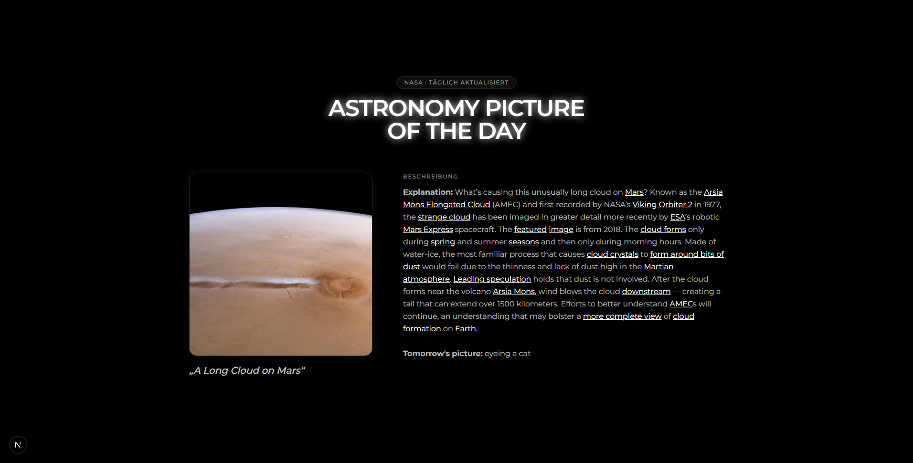
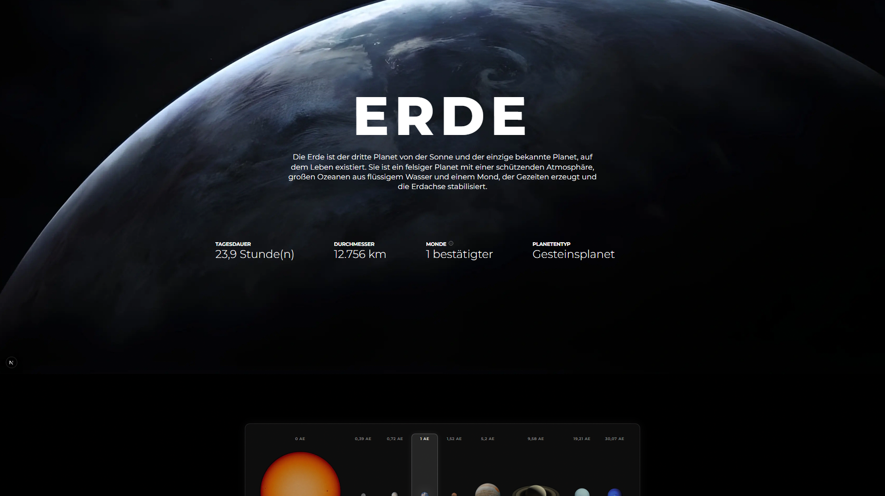
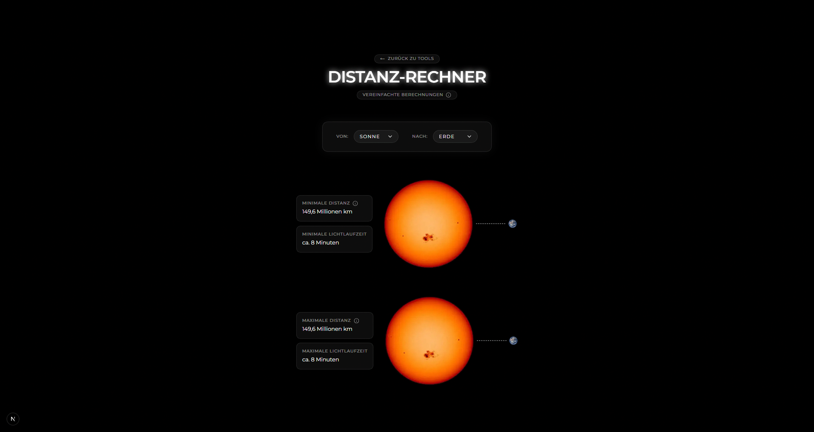
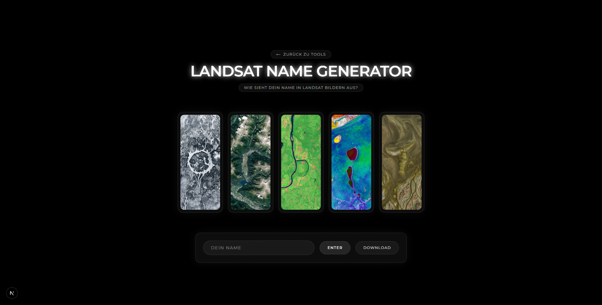

# Orbit 🪐

**Orbit** ist eine interaktive Space/Science-Webapp auf Basis von Next.js (App Router). Die App kombiniert das NASA-Bild des Tages mit kuratierten Datensätzen zu Sonnensystem und Sternbildern und macht daraus verständliche, direkt nutzbare Seiten und Tools.

<p>
  
  
  
  
  
  
  <a href="https://github.com/zeroequalsone/orbit/actions/workflows/ci.yml">
    
  </a>
</p>

## Live Demo

<a href="https://orbit-two-sigma.vercel.app">Orbit 🪐</a>

## Screenshots

<p align="center">
  
  
  
  
</p>
<p align="center"><em>APOD Landing · Sonnensystem · Distanz-Rechner · Landsat Name Generator</em></p>

## Highlights

- **Sonnensystem**: Interaktive Übersicht (`/solar-system`) und Entdecken-Bereich (`/explore/solar-system`) mit Detailseiten zu Sternen, Planeten, Zwergplaneten, Monden und Asteroidengürteln.
- **Sternbilder**: Alle 88 Sternbilder auf einer Himmelskarte (Canvas) mit Hover und Klick, auf dem Handy als durchsuchbare Liste. Pro Sternbild eine Detailseite mit gezeichnetem Sternbild und Fakten. Datenquelle: [d3-celestial](https://github.com/ofrohn/d3-celestial).
- **Tools**:
  - **Gewicht-Rechner**: Körpergewicht auf Basis der Oberflächengravitation der Planeten.
  - **Distanz-Rechner**: Minimale und maximale Entfernung zwischen zwei Planeten (vereinfachtes Modell) inklusive Lichtlaufzeit.
  - **Größen-Rechner**: Volumenvergleich nach dem Prinzip "Wie oft passt X in Y?".
  - **Landsat Name Generator**: Buchstaben-Collage aus Landsat-Bildern, Export als PNG im Browser.
- **NASA APOD**: Die Startseite zeigt das Astronomy Picture of the Day. Die Daten werden serverseitig geladen und stündlich neu validiert.
- **Qualitätssicherung**: Unit-Tests mit Vitest für die Berechnungslogik (Formatter, Planeten-Berechnungen, Landsat-Auswahl, Sternbild-Geometrie) und eine CI mit GitHub Actions (Lint, Tests, Build bei jedem Pull Request). Lighthouse (Mobile, Nov. 2026): Performance 98, Accessibility 100, Best Practices 100, SEO 100.

## Projektstruktur

- `app/page.tsx`: APOD Landing Page
- `app/solar-system/`: Interaktiver Sonnensystem-Explorer
- `app/explore/`: Entdecken-Bereich (Sonnensystem, Sternbilder)
- `app/tools/`: Rechner und Generatoren
- `app/lib/`: Reine Hilfsfunktionen (Formatierung, Berechnungen, Sternbild-Geometrie) samt Tests
- `app/data/`: Kuratierte Datensätze
- `public/data/`: Sternbild-Rohdaten (GeoJSON)

## Tech-Stack

- **Framework**: Next.js (App Router) + React
- **Sprache**: TypeScript
- **Styling**: Tailwind CSS
- **UI**: Radix UI, react-icons
- **Tests**: Vitest
- **CI**: GitHub Actions
- **Deployment**: Vercel
- **Utilities**: `html-to-image` (PNG-Export)

## Lokal starten

### Voraussetzungen

- Node.js 24 und npm

### Setup

```bash
npm ci
npm run dev
```

Dann im Browser öffnen: `http://localhost:3000`

### Weitere Befehle

```bash
npm run lint       # ESLint
npx vitest run     # Tests einmal ausführen
npm run build      # Produktions-Build
```
